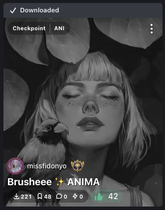
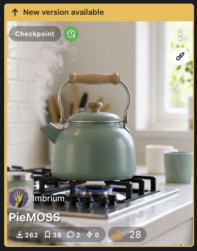

# Send Link to SwarmUI

Send a link from any web page to your SwarmUI downloader with a right-click. The extension opens the downloader with the link filled in, ready for you to review and download.

[Install from the Chrome Web Store](https://chromewebstore.google.com/detail/send-link-to-swarmui/ldpjgjjdhhjpmjinlnmhjchcfdamecnh?hl=en-US)

## Get started

1. Install the extension and make sure SwarmUI is running.
2. Open the extension's options and enter your SwarmUI server URL, such as `http://localhost:7801`. You can also use the URL of a reachable remote server.
3. Click **Save** and allow Chrome access to the server if prompted.
4. Right-click a link and choose **Send to SwarmUI**. If you right-click elsewhere on a page, the extension sends the page URL.
5. Review the link in SwarmUI's downloader and start the download there.

The extension opens SwarmUI on the first send and reuses its tab for later sends. When that tab is still on SwarmUI's Text2Image page, later sends update the downloader without reloading, preserving your SwarmUI state.

The **Open SwarmUI in popup window** option uses a smaller Chrome window for newly opened SwarmUI tabs. An existing tab is still reused.

## Optional: see downloaded versions on Civitai

When browsing model listings on [civitai.com](https://civitai.com/models) or [civitai.red](https://civitai.red/models), the extension can mark versions that match your local SwarmUI library. This feature requires [SwarmUI-WhatTheDuckExtension](https://github.com/jtreminio/SwarmUI-WhatTheDuckExtension); the right-click downloader does not.

1. Install or update WhatTheDuck to a version that supports Civitai version matching, then restart SwarmUI.
2. Set your SwarmUI server URL in the Chrome extension options and click **Save**. Allow server access if Chrome asks.
3. Browse the Civitai model listings. Matches refresh as you browse.

After adding model files, refresh the model list in SwarmUI so WhatTheDuck can update its index. Sign in to SwarmUI in your browser if your server requires it.

- **Downloaded** means the displayed version matches a local file. Its preview is dimmed and desaturated until you hover over or focus the card.
- **New version available** marks a displayed version when a known older version is in your library. An amber bar and rail make it easy to spot.
- Cards with unknown or different-version matches remain unmarked. An unmarked card does not prove that the version is missing from your library.

The status bars sit above Civitai's usual top controls, which remain available.

<table>
  <thead>
    <tr>
      <th>Already downloaded</th>
      <th>Hover or keyboard focus</th>
      <th>New version available</th>
    </tr>
  </thead>
  <tbody>
    <tr>
      <td></td>
      <td></td>
      <td></td>
    </tr>
  </tbody>
</table>

These screenshots show features in this repository. The Chrome Web Store release may not yet include all of them.

## Install from this repository

To try the current repository version:

1. Download or clone this repository.
2. Open `chrome://extensions/` in Chrome and turn on **Developer mode**.
3. Click **Load unpacked** and select the downloaded project folder containing `manifest.json`.
4. Open the extension options and configure your SwarmUI server as described above.

The bundled `dist/` files are included, so you do not need to build the extension to install it.

## Privacy

The extension stores settings and captured model metadata locally. It sends selected links and matching requests to the SwarmUI server you configure, with no developer-operated analytics or collection server. Read the [privacy policy](PRIVACY.md) for details about data handling, retention, and deletion.

## Development

```sh
npm ci
npm test
```

The `dist/` bundles are versioned with the source. Include updated bundles when changing source files.
